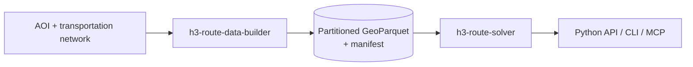

# H3 Route Data Builder

<!--start-->
[](LICENSE)


An ArcGIS Pro / ArcPy pipeline that builds a **sparse, precomputed origin-destination (OD) network
cost dataset** over [H3](https://h3geo.org/) cells and publishes it as partitioned
Parquet/GeoParquet.

Instead of solving every cell against every other cell, the builder only solves cells whose
polygons actually intersect an eligible, traversable edge of the transportation network. Each of
those cells gets one deterministic point on the network, and network costs are solved only
between those points. The result is a much smaller, reproducible dataset of *real* network
costs that can be queried without ArcGIS.

## How It Fits Together

This is one of two projects that share a single data contract:

| Project | Role | ArcPy? |
|---|---|---|
| **h3-route-data-builder** (this repo) | Builds and publishes the sparse OD dataset | Yes |
| [h3-route-solver](https://github.com/knu2xs/h3-route-solver) | Pip-installable library, CLI, and MCP server that queries the dataset | No |



## Key Concepts

- **Solvable cell** - an H3 cell (resolution 10 by default, configurable) whose polygon
  intersects at least one eligible edge for the configured travel mode. Only solvable cells
  ever enter OD work.
- **Network representative** - one deterministic point per solvable cell, on an eligible
  intersecting edge (initially the point nearest the cell centroid, with ID tie-breaking).
  OD costs are solved between representatives.
- **Sparse OD facts** - persisted rows contain *actual* network distance and time only.
  Off-network "stretch" is computed by the solver at query time and never stored as network cost.
- **Resumable work** - OD work is split into deterministic work units tracked in a ledger
  (`planned -> leased -> solving -> staged -> validated -> committed`), so interrupted builds
  resume without losing or duplicating results.
- **Fingerprinted builds** - every dataset is versioned and fingerprinted from the network,
  travel mode, policies, schema, and software versions.

See [System Architecture](docsrc/mkdocs/design/02-system-architecture.md) and
[Data Contract](docsrc/mkdocs/design/03-data-contract.md) for details.

## Pipeline

| Step | Feature spec |
|---|---|
| 1. Select eligible edges, generate intersecting H3 cells, place representatives | [001 AOI cell generation and snapping](docsrc/mkdocs/design/builder/001-aoi-cell-generation-and-snapping.md) |
| 2. Plan sparse OD candidate batches (AOI-only or AOI-to-surrounding) | [002 Candidate generation](docsrc/mkdocs/design/builder/002-candidate-generation.md) |
| 3. Solve OD batches with Network Analyst using a durable work ledger | [003 Resumable OD solving](docsrc/mkdocs/design/builder/003-resumable-od-solving.md) |
| 4. Publish partitioned GeoParquet with manifests and checksums | [004 GeoParquet publication](docsrc/mkdocs/design/builder/004-geoparquet-publication.md) |
| 5. Run workers in parallel with a serial fallback | [005 Parallel execution](docsrc/mkdocs/design/builder/005-parallel-execution.md) |

## Output

| Table | Contents |
|---|---|
| Solvable cells (GeoParquet) | `h3_id_hex`, resolution, cell/centroid/representative geometry, intersecting-edge count, network location fields, snap distance, eligibility status, build fingerprint |
| OD facts (Parquet, partitioned by origin H3) | origin/destination H3, travel mode, network distance and time, solve status, work-unit ID, build fingerprint |
| Manifest | contract and dataset versions, H3 resolution and library version, CRS, fingerprints, policies, partition scheme, statistics |

## Requirements

- Windows with **ArcGIS Pro** and the **Network Analyst** extension.
- A network dataset (or service) with the travel modes you intend to solve.
- Python matching ArcGIS Pro's `arcgispro-py3` (3.11+).

## Getting Started

1. Clone this repo.

    ```
    git clone https://github.com/knu2xs/h3-route-data-builder.git
    cd h3-route-data-builder
    ```

2. Create the environment. This clones `arcgispro-py3`, adds the dependencies in
   `environment.yml`, and installs this package in editable mode.

    ```
    make env
    ```

3. Run the tests.

    ```
    make test
    ```

4. Explore in `jupyter lab` (notebooks in `./notebooks`, reusable logic in `./src`), or open
   `./arcgis/h3-route-data-builder.aprx` in ArcGIS Pro.

## Status and Roadmap

**Pre-alpha / specification phase.** No pipeline code exists yet. Builder work follows phases 1-4
of the [roadmap](docsrc/mkdocs/design/10-roadmap.md):

1. **Geometry spike** - edge eligibility, intersection semantics, deterministic representatives,
   measured sparsity, H3 distance conversion, pentagon behavior.
2. **Sparse builder slice** - AOI to edges to cells to representatives to serial OD to one partition.
3. **Resume/expand** - ledger, leases, reconciliation, fingerprints, AOI enlargement.
4. **Parallel publication** - isolated workers, capability probe, fallback, compaction, verification.

## Development Workflow

Development is spec-driven with [Spec Kit](https://github.com/github/spec-kit) and GitHub Copilot.

- The project constitution lives in [.specify/memory/constitution.md](.specify/memory/constitution.md).
  Every plan is checked against it.
- Coding conventions for AI assistants and humans are in [AGENTS.md](AGENTS.md).
- Feature workflow in Copilot Chat:
  `/speckit-specify` -> `/speckit-clarify` -> `/speckit-plan` -> `/speckit-tasks` ->
  `/speckit-analyze` -> `/speckit-implement`.
- The first feature to specify is the **geometry spike** (roadmap phase 1), using
  [001 AOI cell generation and snapping](docsrc/mkdocs/design/builder/001-aoi-cell-generation-and-snapping.md)
  as input.
<!--end-->

<p><small>Project based on the <a target="_blank" href="https://github.com/esri/cookiecutter-spatial-data-science">cookiecutter
spatial data science project template</a>. #cookiecutterdatascience</small></p>
